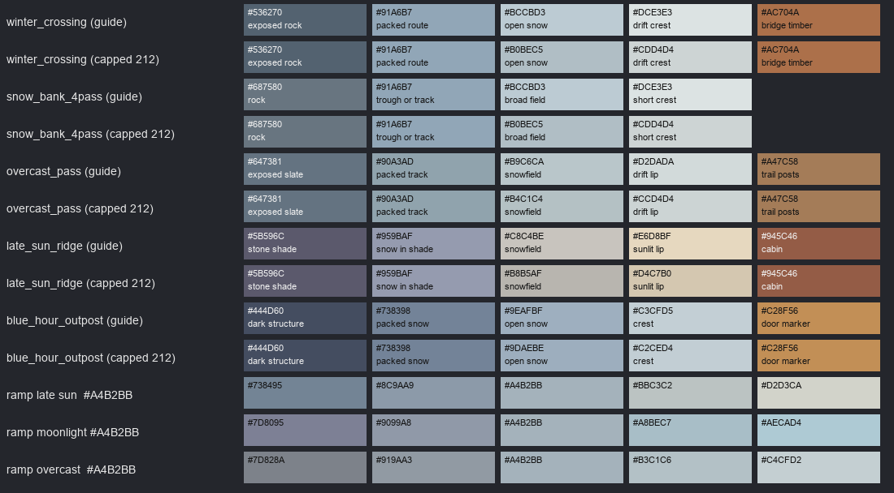

# Colour palettes for AoS maps, with snow and winter in depth

Research consolidated 2026-11-19. It merges the owner-supplied PDF *Color palettes for VXL maps* (field guide, 11 pages),
the colour-theory pages listed in §11, the VXL format and protocol pages, our pyspades 1.4.2 source, and a palette audit of
29 community winter maps plus our own maps.

Evidence tags follow AGENTS.md: `[SRC]` source read · `[RUN]` measured with real code · `[GUIDE]` external guide ·
`[USER]` owner rule · `[DESIGN]` judgement · `[OPEN]` unverified.

**Status:** researched, with tooling (`aosmap/kit/palette.py`, `tools/palette_audit.py`). None of the new palettes has been
client-inspected yet. The PDF's author also says no client or display testing was done for its hex values.


*Guide recipes, the same recipes fitted under the owner's 212 cap, and `shifted_ramp` output for three kinds of light.
Regenerate the sheet with the snippet in §10.*

---

## 0. The short version (read this if nothing else)

1. **Value carries shape, hue and saturation tell materials apart.** Block every scene in three values first: a mid for the
   largest surface, a dark for recesses, walls and rock, and a light for exposed edges. Check it in greyscale. `[GUIDE]`
2. **Decide which colour fills the screen.** On snow maps this decision matters more than any other. The broad field is a
   light grey-blue, **never white**. The brightest snow is a short, broken crest on exposed lips, and covers only a few % of
   the view. `[GUIDE][USER]`
3. **Keep the owner's limits:** snow max channel ≤ 212, walkable floors luma ≥ 40, fog ~150+ per channel in a hue the
   palette doesn't use, neutral between blue and red. `[USER]`
4. **Under the 212 cap, leave headroom.** Keep the broad field at luma ≤ ~180 (e.g. `#A4B2BB`–`#B0BEC5`), so that the
   crest step is still visible. `[RUN]`
5. **Ramps are hue-shifted, not just lighter and darker.** Light steps move toward the light's hue, shadows toward the cool
   side, and both ends lose saturation. Use `palette.shifted_ramp()`. `[GUIDE][DESIGN]`
6. **Reserve accents for meaning.** A warm timber, amber door or rust gate marks a route or entrance only where it means
   that. Don't repeat it on every crate. `[GUIDE]`
7. **Big connected patches, no sparkle.** Isolated bright single voxels flicker in motion and make snow look gritty. `[GUIDE][USER]`
8. **Run `tools/palette_audit.py` on every export** and fix what it flags before client inspection. `[RUN]`

---

## 1. What the format and the protocol let us control `[SRC]`

| fact | detail | source |
|---|---|---|
| Colour lives on **surface voxels only** | A solid voxel stores a colour only if a face neighbour (6-neighbourhood) is air. Buried solids have no colour field. | Barrett spec "Writing a map"; pyspades vxl_c.cpp is_surface |
| 24-bit colour, stored B, G, R, A | Author in `#RRGGBB`. `aosmap.vxl.rgb()` handles the byte order. | spec span table; knowledge base §2.1 |
| The 4th byte is **cosmetic** | The spec calls it shading "in unknown way". Source shows pyspades writes 0x80, OpenSpades overwrites it with 100, and BetterSpades masks it off. The PDF's "uncertain" is superseded by our source reading. Leave it to the exporter. | knowledge base §2.2 |
| **Dug-out faces show brown to late joiners** | When a block is destroyed, pyspades does not colour the newly exposed neighbours. When the server serialises the map for a joining client, any surface voxel without a colour is written as `DEFAULT_COLOR` 0x674028 (dirt brown, RGB 103,64,40). | pyspades `vxl_c.cpp get_write_color`, `vxl.pyx destroy_point` |
| What clients already in game paint on those faces | Client-specific; not verified. | `[OPEN]` |
| You cannot author an "underground colour" | This follows from the two rows above. A snow cap is the upper row of voxels painted white-ish over stone or earth. Digging through it reveals uncoloured interior. | PDF p.1, `[SRC]` |
| Fog and team colours are server state | StateData (packet 15) carries fog B,G,R and team1 and team2 B,G,R. FogColor (packet 27) changes fog live (`/fog r g b`). Colour channels are 0–255 everywhere. | protocol075 |
| Player block colour comes from SetColor (packet 8) | BlockAction and BlockLine have no colour field. A build uses the player's last SetColor. | protocol075 |
| The protocol page's default team names are "Blue"/"Green" | piqueserver config sets Blue (0,0,255) and Red (255,0,0) on our target. | protocol075; AGENTS.md §2 |

Design consequences:
* **Snow over earth is honest.** Digging into a snow bank reveals brown, which reads as soil under snow. On an **ice** or
  **pure-snow island** map, dug holes show brown to late joiners. Accept that, or make the underlying material visibly
  earthy (a rock or soil layer shows in cliff cuts), so the brown makes sense. `[DESIGN]`
* Fog and team colours can be tested live without re-exporting. The terrain palette cannot.

---

## 2. Colour theory, distilled for voxel maps

Terms `[GUIDE]` (Wikipedia, Sessions, DecoArt, Figma, Zollie):
* **Hue** is the colour family. **Value** (lightness) is how light or dark. **Saturation (chroma)** is intensity.
  * A **tint** adds white, a **shade** adds black, and a **tone** adds grey.
* Screens mix light additively in RGB. The painter's RYB wheel is a mixing heuristic, so for maps think in RGB/HSV, or
  better, perceptual OKLab/OKLCH (§8).
* Mixing toward black or grey lowers chroma. Shades of yellow, orange and red **drift toward green or brown** when you only
  darken them. Correct the drift by rotating the hue (see ramps, §3) instead of multiplying RGB. `[GUIDE]` (Wikipedia)

Principles that matter in AoS:
1. **Value first.** If two materials have similar value, they turn muddy even when their hues differ. The quickest check
   is a greyscale screenshot. `[GUIDE]` (Zollie, PDF p.2/p.6)
2. **Limit the families.** Use 3–4 main colours or hue families, with one dominant. This matches our measured calibration
   (2–4 families cover 90 % of good reference maps, knowledge base §10.2). `[GUIDE][RUN]`
3. **Harmony schemes are starting points, not laws.** Taste depends on context and lighting (Wikipedia). How they map to
   maps:
   * **Monochromatic** is one hue family across several values. It suits overcast snow and ash fields, where silhouette
     carries the design. To avoid sterility, add texture, a saturation change or a neutral accent.
   * **Analogous** is neighbouring hues, one dominant, one support, one accent. Examples: olive grass, yellow-green scrub,
     ochre soil; or a blue-grey snow, slate and teal ice. Separate adjacent materials **by value** where their boundary
     matters.
   * **Complementary accent:** a small rust or amber gate in a slate-blue yard marks the route. If every crate also turns
     rust, the gate loses its meaning.
   * **Split-complementary or triadic:** one dominant plus two accents. These suit fantasy, joke and toy maps (Bloomhop,
     Under the Tree).
4. **Warm advances, cool recedes.** Wikipedia attributes this partly to warm pigments usually being lighter and more
   saturated. So the **saturation and value** of a warm accent do most of the work, not the hue alone. Put warm accents
   on the near and important pieces, and let distance and fog stay cool or neutral. `[GUIDE]`
5. **Simultaneous contrast (Chevreul).** A colour shifts toward the complement of its neighbour. Neutral grey snow beside
   warm timber looks bluer, and beside blue ice it looks warmer. Judge swatches in place, never alone. `[GUIDE]`
6. **Proportion.** Use one dominant colour for the big surfaces, a supporting one, and a small accent. None of the pages
   gives a 60-30-10 rule. Our measurement-based equivalent: the dominant field covers the most top surface, and accents
   stay at a few %. `[DESIGN]`
7. **Accessibility.** Around 8 % of men have a colour-vision deficiency (indieklem). Never make a route, hazard or team
   cue depend on hue alone. Give it a **value** difference or a **shape** (a gantry, end posts, a tall entrance), so
   it survives both colour blindness and paint being chipped away. Ubisoft's *Chroma* simulates CVD on screenshots.
   `[GUIDE]` (indieklem, PDF p.2, Xbox AG 103 via PDF)
8. **Test in the final environment.** Lighting, screen and renderer change colour (Sessions). For AoS this means the
   real client with the real fog (§7). `[GUIDE]`
9. **Contrast and session length.** Bright, high-contrast palettes suit short, energetic sessions. Lower contrast suits
   long sessions and causes less fatigue (indieklem). Babel rounds are long, so prefer calm fields with contrast saved for
   routes and landmarks. `[GUIDE][DESIGN]`
10. **Sub-palettes per area.** Not every palette colour needs to be on screen at once. Give each zone (spawn, front, tower
    zone, flank) its own subset of the map palette (indieklem). This is also how players learn where they are. `[GUIDE]`
11. **Team identity by form as well as colour.** TF2 pairs team colours with distinct architecture. For a mirrored Babel
    map: one spawn gets a stepped roof, the other twin stacks, with equal openings and cover. Both stay identifiable after
    the paint is chipped away. `[GUIDE]` (PDF p.2). Check this against the owner's balance rule. Shapes may differ;
    gameplay geometry must stay equal.

---

## 3. Material ramps (hue shifting)

`[GUIDE]` PDF p.2. `[DESIGN]` our implementation.

* **Give each material a short ramp** of 3–5 steps: a dark joint or recess, the **body (mid, used for most of the
  object)**, and a light worn edge. Example pairs:

  | material | dark | mid | light |
  |---|---|---|---|
  | stone | `#4C514C` | `#77796B` | `#A6A38E` |
  | timber | `#55463E` | `#856B50` | `#B7976A` |

  * Stone stays slightly green-grey. Timber shifts toward ochre in the light.
  * Materials that sit side by side should share a similar light-to-dark range.
* **Group the light step** into exposed outcrops and worn rail tops. Identical stripes on every block overpower the shape,
  and 1-voxel high-contrast stripes flicker (`[USER]`).
* **Hue shift:** light steps rotate toward the light's hue (warm sun ≈ yellow-orange), shadow steps rotate toward the
  cool side, and **chroma drops at both ends**. A ramp that only multiplies RGB gives muddy shadows and neon highlights.
* **Greys have no hue to shift.** Snow, ash and concrete get their temperature from a small tint at the ends:
  `end_tint` ≈ 0.02 OKLCH chroma.
* Tools named by the sources: ColorRampCreator (mycours.es) auto-builds ramps. Lospec hosts published palettes.
  Pixel-art palettes (PICO-8, AAP-64, Endesga 32, Dawnbringer 32) are fine as **hue inspiration**. Their extremes are too
  saturated and too bright for AoS fields; borrow mid tones and accents only. `[GUIDE][DESIGN]`

```python
from aosmap.kit import palette as P
P.shifted_ramp(P.hex_rgb('#856B50'), n=5)                         # timber, warm light / cool shadow
P.shifted_ramp(P.hex_rgb('#A4B2BB'), 5, light_hue=70, end_tint=0.02, cap=212)              # late-sun snow
P.shifted_ramp(P.hex_rgb('#A4B2BB'), 5, light_hue=220, shadow_hue=290, end_tint=0.02, cap=212)  # moonlit snow
```

---

## 4. Snow and winter maps (the main problem)

### 4.1 What goes wrong: an audit of 29 community winter maps `[RUN]`
`tools/palette_audit.py` on `map_collection/` winter maps, 2026-11-19. Top surface = what a player sees from above, z 63
excluded. "Over cap" = snow-like top voxels with a max channel > 212. "Brightest band" = top voxels within 10 luma of
the map's brightest.

| map | snow share | dominant top colour (share) | over cap | brightest band | verdict |
|---|---|---|---|---|---|
| 1river2white | 100 % | `#FFFFFF` (100 %) | 100 % | 100 % | the "too white" extreme; fog 255,255,255 |
| SnowyApoc / icebreak / winter | 95–100 % | `#FEFFFF`-ish (67–96 %) | ~99 % | 75–96 % | white fields, crest = field, so slopes vanish |
| Snow2 / QuintuIceland | 99 % | `#F1F2F2` / `#EFF1F1` (41–45 %) | 92 % | 41–46 % | near-white with some steps |
| holes-snow | 100 % | `#DAE9EB` (79 %) | 92 % | 0 % | pale cyan field; one value everywhere |
| capitol-snow / crossfire2-snow / xmasfire2 | 95–100 % | `#B3CFD3`/`#B6D2D6` (42–48 %) | 31–57 % | 0.2–39 % | better field, but crests and buildings white |
| ChristmasPVP | 56 % | `#BECBD2` (50 %) | 11 % | 3 % | good field (≈ guide's `#BCCBD3`), but 46 sparkle/10k and 6 hue families |
| alpine / Alpine2024 | 9 % | `#091609` dark conifer (12 %) | 2.5 % | 0.9 % | snow only on peaks; 23 % of tops < luma 40 (conifer canopies) |
| alpine_desaturated | 9 % | `#484848` (22 %) | 0.3 % | 0.9 % | the owner's "calm snow" reference: grey world, small snow, tiny crest |
| MarshAlpine | 12 % | `#3E4A34` (18 %) | 1.2 % | 0.7 % | green-dominant, snow as accent |
| winterclash | 18 % | `#89909C` (29 %) | 0.3 % | 0 % | mid-grey field; sparkle 51/10k |
| **Silverpine Hunt v2.2 (ours)** | 3 %* | `#979DB0` shaded snow (11 %) | **0 %** | 0.1 % | max top luma 205; see 4.4 |
| **Yulehaven Isles v1.0 (ours)** | 22 % | `#646161` rock (15 %) | 0 % | 0 % | max top luma 208; fog = snow field (dE 0.7); sparkle 94/10k; see 4.4 |
| **Frostbell Hollow v1.2 (ours)** | 0 %* | `#535766` twilight slate (35 %) | 0 % | 1.6 % | twilight grade: every top ≤ luma 122; see 4.4 |
| **Tradeoff Christmas v1.0 (ours)** | 80 % | `#CDB1B9` pink-lit snow (18 %) | 20 % | 0.3 % | max top luma 244 outside glow; fog ≈ 6 snow tones; see 4.4 |

Our maps are measured with glow-stored voxels excluded (they are deliberate light, knowledge base §11.4).
\* Silverpine's moonlit snow is mid-value (#979DB0 ≈ OKLab L 0.68), below the "snow-like" L > 0.72 threshold. The 3 % is
its crests. That is intended: shaded snow.

Reading: the community snow maps fail in exactly the two ways the owner's players complain about. Either the field is
white (the screen glares and slopes disappear, because the crest = the field), or white buildings and props sit on a pale
field. The maps that read well (alpine_desaturated, MarshAlpine, Silverpine v2) use snow as **a value band inside a darker
world**, not as the whole world.

### 4.2 Rules for snow `[GUIDE][USER][RUN]`
1. **Pick the field colour first.** It covers most of the view. Use a light **grey-blue or grey-cream**, never white.
   Under the owner's 212 cap, keep it at **luma ~165–185** (`#A4B2BB`, `#B0BEC5`, `#B4C1C4`), so a crest step of
   +15–25 luma still fits. The guide's own field `#BCCBD3` (luma 200) leaves almost no room under 212.
   These are **day / overcast** values. On a night or twilight map the whole palette sits under a DARK grade
   (knowledge base §11.4): the snow field drops with it (Silverpine ~150, Frostbell ~90–120) but stays the **lightest
   broad band**, with floors still ≥ luma 40 and the fog brighter than the terrain.
2. **Paint the bank in four passes** (PDF p.3):
   1. **Field.** Broad-field colour on every snow surface. No white in the first pass. Judge it from the spawn exit
      looking at the biggest open slope.
   2. **Trough.** Use a darker snow in a few connected patches along packed trails, tracks and the lee of drifts,
      following the contour. A checkerboard of dark voxels looks gritty.
   3. **Crest.** A short, **broken** highlight on exposed lips only; leave neighbouring snow untouched. If it dazzles,
      shrink its area first, then darken the field one step.
   4. **Reference.** Give the eye a non-snow anchor: rock below a cut, timber at a crossing, a grey-green treeline. If the
      result looks like grey concrete, add form (scalloped drift, overhanging cap, partly buried fence) **before** adding
      brightness.
3. **Coverage targets** `[DESIGN]`, from 4.1 and knowledge base §10.2:
   * brightest band ≤ ~5 % of the top surface;
   * top-down bright share (luma > 175) under ~10 % unless the map is a deliberately bright day map;
   * sparkle (isolated bright voxels) under ~20 per 10k columns. The metric is top-down, so a 1-voxel pale post or candle
    top on dark ground counts too. Check flagged maps visually before repainting.
4. **Snow follows form.** It belongs on gentle and high ground; steep faces show rock (knowledge base §10.3). A snow cap is
   the upper voxel row over stone, so leave stone visible beneath it. Caps cover whole tier sectors of trees, not single
   voxels (Silverpine v2).
5. **The cap trick: neutral-to-warm crests get more light.** The 212 cap is a **max-channel** limit, so a blue-tinted crest
   hits it on the blue channel first. A moonlit `shifted_ramp` crest tops out at luma ~195, a late-sun cream crest at ~210.
   When a crest must pop, nudge it toward neutral or cream, not toward blue-white. `[RUN]`
6. **Fit published recipes under the cap by scaling the whole snow family** (`palette.cap_snow`), not just the brightest
   swatch. Clipping only the crest erases the crest-to-field step. `STARTERS_CAPPED` holds the guide's snow recipes fitted
   this way. The same applies to `kit.color.enforce_brightness`: it scales **each** voxel over 212 down to 212 on its own,
   so a `#DCE3E3` crest and a `#E4EEF2` crest both land at max 212. Author snow under the cap with
   `shifted_ramp(..., cap=212)` and leave `enforce_brightness` as the safety net (it should report ~0 whites capped).
7. **Team readability on snow.** Blue players vanish first against shaded blue snow and cool fog. Stand each team at the
   same wall and cross the lane. If blue disappears, move that bank toward neutral grey or change its value. Re-check red
   against warm cabins and amber markers. (PDF p.4/p.6)
8. **Dark anchors stay ≥ luma 40 on walkable tops.** Rock, structures and forest masses provide the dark band. They are
   what makes snow read as bright without being white.

### 4.3 Winter light presets `[GUIDE]` (PDF p.4; fitted under the cap in `STARTERS_CAPPED`)
| light | dark | trough/track | field | crest | accent | notes |
|---|---|---|---|---|---|---|
| Overcast pass | slate `#647381` | `#90A3AD` | `#B9C6CA` → capped `#B4C1C4` | `#D2DADA` → `#CCD4D4` | trail posts `#A47C58` | soft transitions; break the horizon with trees or a rock cut |
| Late sun on a ridge | stone shade `#5B596C` | snow in shade `#959BAF` | `#C8C4BE` → `#B8B5AF` | sunlit lip `#E6D8BF` → `#D4C7B0` | cabin `#945C46` | warm light on one side and repeated on caps, shaded run cool (warm sun / cool skylight) |
| Blue-hour outpost | `#444D60` | `#738398` | `#9EAFBF` | `#C3CFD5` | door marker `#C28F56` | amber only at the entrance; keep light snow behind players near dark structures |
| Winter crossing | rock `#536270` | packed route `#91A6B7` | `#BCCBD3` → `#B0BEC5` | `#DCE3E3` → `#CDD4D4` | bridge timber `#AC704A` | strip of packed snow from spawn to the crossing |
| Moonlit night (ours) | `#7D8095`-ish ramp | | `#979DB0` (Silverpine) | ≤ luma 205 | amber windows (glow) | night = DARK grade + glow (knowledge base §11.4) |

Published palettes worth borrowing from (PDF p.4):
* MagicPixel *Blizzard*: `#BFCFD9` as the field and `#E4EEF2` (scale under the cap) on a few ridges. Leave its
  `#FFFFFF` unused.
* Lospec *Snowfall*: cool `#A8BEDE` paired with warm `#F7E9C4` is a sunset starting pair. Scale it under the cap.

### 4.4 What this means for our own maps `[RUN][DESIGN]`
* **Silverpine Hunt v2.2** already passes the cap (0 % over, max top luma 205). Its fog (170,160,190) is only
  **dE 3.6** from its dominant shaded snow `#979DB0`.
  * For ground that is harmless: it simply doesn't change with distance.
  * The guide warns that when fog and snow meet at the same value, the horizon becomes one band.
  * Silverpine relies on dark conifer masses and slate ridges for its skyline, which is the guide's recommended rescue.
  * If a v3 is made: test a fog ~10 luma lighter or slightly warmer, and check the platform and ridges at 60–110 voxels.
* **Yulehaven Isles v1.0**: snow is under the cap (0 % over, max top luma 208) but the fog (172,174,192) is the **same
  colour as its second-commonest snow** `#A7AFC0` (dE 0.7). Snowy ridges dissolve straight into the air. Its sparkle
  (94 per 10k columns, the highest measured) comes from small pale tops on dark rock: candles, posts, snow dots.
  Both are worth a look in the client. Fixes in order: fog ~10 luma lighter or a step warmer (mauve
  (190,168,176)); merge single pale voxels into connected caps.
* **Frostbell Hollow v1.2** (twilight): every top is ≤ luma 122 and 92 % neutral; the snow reads as slate. That is the
  twilight grade working, and the opposite of "too white". If players find it too dark, lift the snow field alone
  (not rock or buildings) toward luma ~130–140. The fog (166,160,188) is brighter than all terrain, as the night rule
  wants.
* **Tradeoff Christmas v1.0**: outside glow-lit voxels, 20 % of snow is still over the cap (max top luma 244), and the
  fog (182,166,208) sits within dE 4.5–6.3 of six snow tones. Run `palette_audit` again after any v1.1 recolour.
* `the_hollow_crown`, `graveyard_of_the_forgotten` and `under_the_tree` show "snow-like" voxels over 212. These are bone,
  pale stone and white props, a small share of the top surface (the audit only flags it when snow-like voxels cover
  ≥ 2 %).
* `kestrel_spires` art v3: fog (200,188,206) is dE 8 from its #2 sandstone. That is ground merging into the fog, which is
  fine. The landmark spires were already moved off tan fog.
* `hollowfen_vale`: fog (118,92,124) is below the owner's ~150 brightness preference. It predates the rule; note it for
  any v2.

---

## 5. Palettes beyond snow `[GUIDE]` (PDF p.5; original recipes, not client-tested)

| biome | colours (where to paint) | key advice |
|---|---|---|
| Woodland river valley | tree shade `#465146`, meadow `#778568`, trail `#A59C7D`, riverbank `#706052`, bridge post `#B78954` | broad meadow clearings joined by a tan trail. If green-ish players blend into trees, expose pale soil or stone on the play-facing bank |
| Desert canyon | cliff recess `#75594D`, sandstone `#BE946D`, open sand `#D9B991`, gravel path `#948673`, pump house `#517A7A` | keep large sunlit flats one step below the palest sand. The blue-green accent goes only on route-related fittings |
| Industrial rail yard | door recess `#414B50`, concrete `#727E80`, platform lip `#A3A5A0`, rust cladding `#86604F`, route stripe `#CD994A` | broad quiet panels behind moving players. Ochre on a few posts at the crossing, plus a gantry so the landmark survives paint damage |
| Volcanic highlands | basalt recess `#3F4247`, ash field `#65636A`, worn ledge `#969295`, cinder path `#78665B`, kiln marker `#C58459` | pale ash behind dark cover so outlines read. Cinder path through shallow cuts. If orange reads as a hazard, reduce it elsewhere |

These sit alongside the palettes that already worked for us (knowledge base §10.7: Halloween, swamp, snow forest).

---

## 6. Choosing fog `[GUIDE][USER]`

**Procedure.** Take a screenshot facing the objective. Sample:
* the largest terrain surface,
* the orienting landmark,
* the objective (Babel's cyan platform),
* **both team colours**.

Choose a **low-saturation** fog hue that falls in a gap of that set. Keep the fog as muted as the landscape, so it ties
in while the hue difference preserves the skyline. (PDF p.7)

**Fix with the smallest change** (PDF p.7):
* **Landmark dissolves.** First move the fog to an unused hue family. If the outline still disappears in greyscale,
  separate the values or make the landmark wider and taller. (Kestrel Spires: tan fog swallowed the sandstone; slate-green
  `(152,174,168)` fixed it.)
* **Objective dissolves.** Babel's cyan platform vanished in blue-green fog. Try muted lilac. If it is still faint,
  give the ground below a darker rim or two distinctive end posts. (The platform itself is script-built; never put it in
  the VXL.)
* **Snow and sky glare.** Keep white out of the fog. Use pale moonlit lilac-grey above cool snow. If the horizon becomes
  one band, deepen the exposed ridge before brightening the snow.

**Trial pairings** (PDF p.8; fog values from our archive, pairings untested):

| scene | ground | landmark | fog |
|---|---|---|---|
| overcast snow | `#B9C6CA` | slate `#647381` | moonlit lilac-grey (168,164,178) |
| late-sun snow | `#C8C4BE` | russet `#945C46` | slate-green (152,174,168) |
| blue-hour outpost | `#9EAFBF` | amber `#C28F56` | dusty mauve (190,168,176) |
| woodland valley | `#778568` | `#B78954` | pale lilac-grey (178,172,192) |
| desert canyon | `#BE946D` | teal `#517A7A` | slate-green (152,174,168), or pale lilac-grey if the teal fades |
| industrial rail yard | `#727E80` | ochre `#CD994A` | lilac dusk (200,188,206) |
| volcanic highlands | `#65636A` | `#C58459` | gray-green mist (152,168,154) |

`check_palette` flags three of these pairings as "fog nearly equals" a mid snow or ledge tone (dE < 8). That is
expected and fine for ground (§4.4). It matters only if that tone is on a skyline, landmark or objective.

**Team neutrality, made measurable.**
* `palette.fog_team_lean()` warns when the fog has real chroma (OKLCH C > 0.035) and its hue lies within 30° of a team
  hue (blue ≈ 264°, red ≈ 29°).
* Our lilac fogs (hue ~300–315°) pass: violet sits between the two teams.
* Community night-snow fogs like (35,55,75), (70,70,100) and (0,60,100) fail.

---

## 7. Testing palettes in the client `[GUIDE]` (PDF p.6/p.10) + our tooling

1. **Slice first.** Before recolouring a whole map, export a representative slice in a normal-sized map: a lane with a
   ramp, trench, doorway and one distant ridge. Reopen the export (our reader + pyspades), then dig in-game to see the
   newly exposed faces (§1: brown for late joiners).
2. **Same view twice.** Use the target server with its real fog and team colours. Record client, renderer, settings
   (OpenSpades ambient occlusion changes shading) and the viewpoint for every screenshot. Capture three views:
   * spawn looking out,
   * the brightest open lane,
   * a trench looking up.

   Change **one** thing (field fill, or crest coverage, or fog) and recapture. Hold display brightness fixed. Try the
   other clients the players use (BetterSpades, OpenSpades, aos_web).
3. **Diagnose what disappears:**
   * **White plane, invisible lip:** reduce the lightest paint's area; put a band of packed snow below the lip.
   * **Camouflaged player:** each team in turn at the same wall, then crossing the lane. Change backdrop value where the
     silhouette breaks.
   * **Route vanishes at distance:** shrink the screenshot to a thumbnail and look at it in greyscale. Widen the path or
     give its entrance a tall, distinct shape.
   * **Terrain sparkles in motion:** walk sideways past the bank. Replace scattered bright single voxels with fewer,
     connected patches.
4. **Fog stations** (owner observations, knowledge base §11):
   * near spawn exit;
   * ~60 voxels, where strong blending starts (check one player of each team and the objective);
   * ~110 voxels, the far draw distance (only large silhouettes survive: 13–15-voxel birds yes, 5-voxel birds no).
5. **Acceptance test.** A fresh player points to the route and the first cover from each spawn, and says which snow view
   is easier to look across after a full crossing. Save the winning screenshots together with the swatches and fog RGB,
   sky setting, client and renderer.
6. **Try fogs without repainting:** `/fog r g b` live, then `fog = (r, g, b)` in the `.txt`. `heavens_color` is
   owner-setup only (stock 1.4.2 ignores it): test with it absent if the map will run on stock servers.

Automated pre-check (add to every export, knowledge base §15):
```bash
python tools/palette_audit.py maps/<map>_vN/<map>.vxl            # reads fog from the .txt beside it
python tools/palette_audit.py a.vxl b.vxl --fog 168,164,178 --json audit.json
```

---

## 8. Tools added `[RUN]`

**`aosmap/kit/palette.py`**
* Conversions: hex ↔ RGB, Rec.601 `luma` (the project's floor convention), OKLab/OKLCH, `delta_e` (OKLab ×100).
* `shifted_ramp(mid, n, light_step, hue_shift, light_hue, shadow_hue, chroma_ends, end_tint, cap)` builds a
  hue-shifted ramp. The cap shortens the light side first, so the mid stays the colour you chose.
* `cap_snow(colours)` scales the whole snow family under 212. `STARTERS_CAPPED` holds the guide's snow recipes fitted
  this way.
* `STARTERS` holds every guide recipe; `FOG_PAIRINGS` holds the trial fog for each.
* `check_palette(colours, fog, floors)` checks:
  * snow over the cap and floors under luma 40;
  * a value range narrower than 70 luma;
  * fog under ~150, near-white, sharing a hue family with the palette, nearly equal to a swatch, or leaning toward a team.
* `fog_team_lean()` and `grade()` (night DARK multiplier plus tint).

**`tools/palette_audit.py`** measures a finished VXL:
* value bands, the dominant top colour and its share;
* snow share and % over the cap;
* dark tops (< luma 40, which includes canopies and roofs, so check whether they are walkable);
* brightest-band coverage and sparkle per 10k columns;
* hue families covering 90 %;
* fog checks.

It prints a verdict and can write JSON.

Why OKLab: in HSV a "lighter" step of the same hue changes perceived hue and saturation unevenly (blue gets purple,
yellow gets green). OKLCH keeps hue steady while lightness changes, so a hue shift is a deliberate choice, not an
accident. `[DESIGN]`

---

## 9. Open questions `[OPEN]`

* What each client paints on faces exposed by digging, for players already in the game. (Late joiners get pyspades'
  brown 0x674028 `[SRC]`.)
* Whether OpenSpades ambient occlusion or BetterSpades shading makes the 212 cap too dark or too bright in practice. The
  cap came from owner feedback, client unrecorded.
* Thresholds for "brightest band ≤ 5 %" and "sparkle < 20 per 10k" are judgement from the audit, not playtested.
* The trial fog pairings in §6 have never been seen in a client.

## 10. Regenerate

```bash
python tools/palette_audit.py <maps...> --json audit.json          # audits (§4.1 used map_collection/ winter maps)
python -c "from aosmap.kit import palette as P; print(P.STARTERS_CAPPED)"
```
The swatch sheet `docs/img/palette_snow_swatches.png` was drawn with PIL from `STARTERS`, `STARTERS_CAPPED` and three
`shifted_ramp` calls on `#A4B2BB` (late sun `light_hue=70, end_tint=0.02`; moonlight `light_hue=220, shadow_hue=290,
end_tint=0.02`; overcast default), each with `cap=212`.

## 11. Sources

* Owner-supplied PDF *Color palettes for VXL maps — field guide 01* (11 pp., 2026-11). Its sources include:
  * Barrett's VXL spec; the piqueserver protocol docs; OpenSpades and its AO wiki; Vengi formats;
  * Mitchell, Francke & Eng *Illustrative Rendering in Team Fortress 2*; Xbox Accessibility Guideline 103;
  * *Daylighting and Lighting* fig. 7.2;
  * MagicPixel *Blizzard*; Lospec snow tag and *Snowfall* (dots).
* Sean Barrett, *Ace of Spades map file format* — https://www.silverspaceship.com/aosmap/aos_file_format.html
* piqueserver mirror — https://www.piqueserver.org/aosprotocol/mapformat.html; protocol index
  https://www.piqueserver.org/aosprotocol/ and 0.75 protocol https://www.piqueserver.org/aosprotocol/protocol075.html
  (StateData's stated 52-byte size disagrees with its field list (32 bytes). Treat it as unreliable.)
* pyspades 1.4.2 `vxl_c.cpp` (`get_write_color`, `DEFAULT_COLOR`), `vxl.pyx` (`destroy_point`) — read 2026-11-19.
* Indieklem, *Creating a harmonious color palette* (2025): mood sub-palettes, contrast vs session length,
  accessibility, Chroma. Thin on technique.
* Stuart's Pixel Games, *Retro game colour palettes and tools* (2018): limited palettes (Game Boy → PICO-8 → AAP-16),
  ColorRampCreator, a palette list. A 2021 commenter warned that one linked ramp site had turned malicious; don't follow it.
* Colour-theory primers: Zollie Makes *Color Theory 101*; Sessions College *A guide to color theory*; DecoArt *Color
  wheel basics*; Wikipedia *Color theory*; Figma *What is color theory*.
  * Medium (*Creative basics: color theory*, @iamjesseshow) returned HTTP 403 and was not read.
* Our measurements: `tools/palette_audit.py` on 29 `map_collection/` winter maps, `refs/yulehaven_isles`, Silverpine Hunt
  v2.2 and our released maps (2026-11-19).
