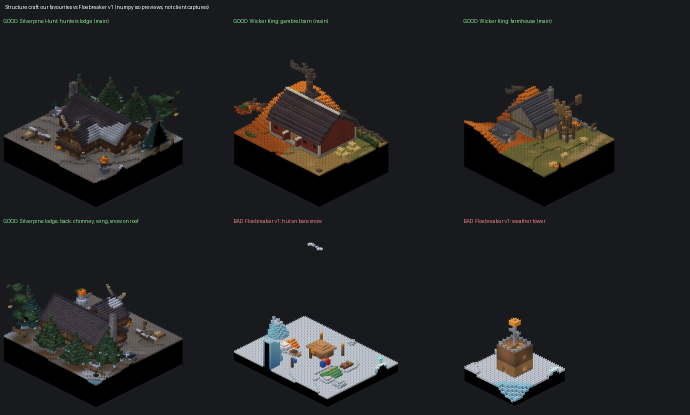

# Craft standard: structures, spawns (every game mode) and the release gate

Written 2026-11-20 after the owner's verdict on Floebreaker v1: *"I am not impressed … you were doing great then
started sacrificing quality. The structures in this map look horrible. Refer back to Wicker King's Harvest, Death
Swamp and Silverpine Hunt. Also, we need to improve your spawns (for all game modes, not just Babel)."* `[USER]`

This is the standard that **every model** working on a map follows: the planner, `map-builder` (Opus) and
`map-runner` (Sonnet). It is enforced by `python -m aosmap.kit.craft_checks` and by a visual review. Evidence tags
follow AGENTS.md §3.

*Top row and bottom left: what the owner praised. Bottom middle and right: what he rejected. Numpy iso previews,
not client captures.*

---

## 0. The short version

1. **Build with the kit, start to finish.** `aosmap.kit` palette ramps → `color.lighting` (baked light + AO) →
   `enforce_brightness`; `veg` for plants; `structures` for stairs and doors. Hand-rolled flat colours with noise
   on top are a prototype. Floebreaker v1 skipped the kit, and that is most of why it looked cheap. `[RUN]`
2. **Main buildings are landmarks.** Each one is at least 200 cells of footprint and 12 voxels tall. It has a real
   pitched roof (gable, hip, gambrel, 45°) with a ridge and eaves, two or more volumes (a wing, porch, tower,
   chimney or lean-to), 30+ colours from material courses, trim and baked light, and real rooms and openings. It
   stands in a dressed yard of 8+ small props telling a story. `[RUN]` (calibration §2.3)
3. **Small buildings are still buildings.** They get a pitched roof, trim around every opening, a base course, and a
   prop or two outside. A box with a stepped lid is not a hut.
4. **Ground has value structure.** Paths, yards, slopes, shadows and material changes give the ground a luma spread
   of ~80+ between p10 and p90 (Silverpine 112, Wicker 80). Floebreaker v1 had 35: a white sheet. Follow
   `docs/colour_palette_guide.md` (snow field luma ≤ ~180, crest ≤ 5 %, fog never equal to the ground). `[RUN]`
5. **Every spawn is a designed place.** It is a yard, camp, pad or room with cover within 8 voxels for at least
   35 % of the spawn spots (Silverpine 65 %, Wicker 42 %, community median 66–70 %). No spawn spot sits on a roof,
   canopy or rock top. There is no water, the relief is ±1, and players are never stuck in a pocket. The rules
   for each mode are in §3, from the server source. `[SRC][RUN]`
6. **Quality must not decay as a build gets long.** The art pass, the last structures and the release get the same
   review as the first building. If time is short, ship fewer structures done properly, not more done badly.
   `[USER]`
7. **Gate before release.** `craft_checks` passes for every registered `main`/`small` structure and every spawn
   set. A close-up sheet of every main building and both spawns is compared side by side with the image above. If
   ours looks plainer, it is not done. `[DESIGN]`

---

## 1. What went wrong in Floebreaker v1 (so nobody repeats it) `[RUN]`

| cause | evidence |
|---|---|
| Built outside the pipeline: generic recreate skill instead of `/recreate`, no `tools/recreate_analysis.py`, no planner/builder/runner split, own primitives instead of `aosmap.kit` | session log 2026-11-20; `scenes/floebreaker/fb_core.py` re-implements box/stairs/noise |
| Skipped `docs/colour_palette_guide.md` on a snow map | palette audit: 72 % of the ground above luma 190, one snow colour on 39 % of the view, fog within ΔE 5 of the ground |
| No baked lighting; flat material colours with low-frequency noise | ground neighbour jump 0.5 (community median 4.7); top-luma p10–p90 168–203 |
| Huts were 9 × 7 boxes with a 2-step flat lid; weather towers were plain stacked boxes | `craft_checks`: huts `roof_pitched` 0.28–0.35 (exemplars 0.69–0.91), main buildings absent |
| Props scattered singly on a bare snowfield instead of composed scenes | yard close-ups; colours per building 10–14 (our good maps 33–61) |
| Open, featureless spawn yards | spawn cover within 8 voxels: 8 % (Silverpine 65 %, Wicker 42 %) |
| Gate chasing late in the build replaced looking at the map | fixes went to rule numbers; nobody compared close-ups with the exemplars |

---

## 2. Structures

### 2.1 What the exemplars do `[RUN]` (close-ups in `docs/img/craft/`, community maps measured locally in `H:/maps`)

* **Silverpine Hunt lodge.** An L-plan: a main hall plus a gabled two-storey front wing. The 45° roof has overhanging
  eaves and partial snow. Outside are a stone chimney, a stone base, a porch with a railing, a balcony and antlers on
  the gable. Inside are rooms, stairs and furniture. The yard has a sawhorse, axe stump, lanterns and tree framing.
* **Wicker King barn.** A gambrel roof in plank rows with a contrasting ridge trim, white corner and door trim,
  board-textured walls and a base strip. It has a cupola and vane, open doors with an X-frame, and hay bales outside.
* **Wicker King farmhouse.** Two volumes with a lean-to, a porch, lit windows, a fenced plot and a wind pump nearby.
* **Death Swamp.** No buildings, but the same craft in natural props. Noise-warped boulder mounds with dark
  hollows, dead trees with root flares and radiating branches, hanging moss, terraced banks and halos painted
  into the water. Every prop belongs to one mood.
* **Community maps that score highest** (MasaiCity, SpookyMansion, GoodbyeBase, Oasis/Joey Ray's Bayou by JoJoe
  Stinky). Timber framing (dark beams on render), steep gables with ridge caps, chimneys, contrasting frames on every
  window, string courses between floors, attached sheds, fenced gardens and paths. Buildings are clustered into
  hamlets with 4–10 voxel lanes, not spread one per field.

### 2.2 Rules `[DESIGN]` from the exemplars, `[USER]` where marked

* **Silhouette first.** Roof pitch, chimneys, towers and wings make the read at 60–110 voxels (draw distance). A flat
  lid reads as a crate.
* **Roof:** gable, hip, gambrel or mansard, rising at least 30 % of the building's height. It has a visible ridge
  cap, eaves overhanging by at least 1, and rows of tile, plank or thatch in 2–3 close tones. Theme accents go on
  top, such as snow, moss or a broken corner. Flat roofs only when the theme demands them (bunker, ship deck,
  desert house), and then with a parapet, crenellation or trim band and rooftop clutter.
* **Walls:** a material texture in courses (logs, boards, stone, brick, render with beams) of 3–5 close tones. Add a
  1–2 high base course in a different material, corner posts or quoins in a contrasting trim colour, and a string
  course between floors.
* **Openings:** every door and window gets a contrasting frame (lintel, sill, jambs). Doors are 2 × 3 or larger.
  Windows sit in rhythm, lit at night (glow). `[USER]` Every structure is real: open doorways, rooms, stairs to
  every floor and furniture.
* **Massing:** main buildings combine at least 2 volumes. Rotate and vary neighbours. Not every building faces the
  same way.
* **Scale:** main buildings ≥ 200 cells and ≥ 12 tall. Small buildings (sheds, huts) still get the full treatment.
* **Setting:** every building sits in a yard. Trampled ground, paths to its doors, 8+ props for a main building (4+
  for a small one) arranged as a story (woodpile by the door, cart by the barn, forge by the camp), framing trees or
  rocks, fences or low walls. No building stands alone on an untouched field.
* **Natural props** (rocks, trees, ice, bone) get the same care. Shapes come from noise-warped primitives, with
  hollows, roots and caps, colour that follows form (light top, dark underside, moss or snow on the right faces),
  and groves and clusters rather than even scatter. `[USER]` Vegetation: three random details per plant, grove
  placement, smooth colour gradients.
* **Lighting is baked.** `aosmap.kit.color.lighting` on every surface voxel: a key light direction and AO under eaves,
  inside doorways and at wall feet. Without it a voxel building looks like a coloured box in any client.

### 2.3 Measured gates (`aosmap.kit.craft_checks`, `CRAFT_GATES`) `[RUN]`

Generators register every structure in `build.json` as
`structures: [{'name', 'box': [x0, x1, y0, y1], 'role': 'main'|'small'|'tower'|'ruin'|'vessel'}]`.

| metric (how it is measured) | main | small | tower | ruin / vessel |
|---|---|---|---|---|
| footprint area / height | ≥ 200 / ≥ 12 | – | height ≥ 14 | – |
| `roof_pitched`: share of the roof off its single most common level | ≥ 0.65 | ≥ 0.60 | – | – |
| `roof_rise_share`: eave → ridge as a share of height | ≥ 0.30 | ≥ 0.25 | – | – |
| `massing`: roof clusters ≥ 3 above the eaves + 1 | ≥ 2 | – | ≥ 2 | vessel ≥ 2 |
| `colours`: distinct exposed colours (÷8) | ≥ 30 | ≥ 20 | ≥ 30 | ≥ 30 |
| `wall_value_range`: wall luma p90 − p10 | ≥ 15 | ≥ 15 | ≥ 15 | ≥ 15 |
| `openings_per_10_perim` | ≥ 3 | ≥ 2 | ≥ 2 | ≥ 2 |
| `indoor_share`: roofed air in the footprint volume | ≥ 0.20 | ≥ 0.20 | ≥ 0.15 | vessel ≥ 0.15 |
| `yard_props`: 1–6 tall objects within 10 of the walls | ≥ 8 | ≥ 4 | ≥ 4 | ruin ≥ 6 |

Calibration (`tools/craft_calibrate.py`):

| building | role | result |
|---|---|---|
| Silverpine lodge | main | **pass** |
| Silverpine watch-house | ruin | **pass** |
| Wicker barn | main | **pass** |
| Wicker farmhouse | main | **pass** |
| Wicker shed | small | **pass** |
| normandie houses and church | main / small | fail on colours (6–15) and roof rise: a 2012 flat-colour style, below our bar by design |
| Floebreaker huts | small | **fail**: roof_pitched 0.28–0.35 |
| Floebreaker weather tower | tower | passes the numbers but is visibly plain: see §5 |

The numbers are a floor. They catch flat lids, boxes, missing rooms and bare yards. They cannot see beauty, so §5
adds the visual review.

---

## 3. Spawns for every game mode

### 3.1 How each mode places players (piqueserver / pyspades 1.4.2, read in source) `[SRC]`

| mode | rule | source |
|---|---|---|
| CTF, TDM (no hook) | a random **land** column (solid at z 62) in the team strip **x 0–127** (team 1) / **384–511** (team 2), **y 128–383**; the player is put on the **topmost solid voxel** of that column | `pyspades/team.py get_random_location`, `server.py`, `vxl_c.cpp get_random_point` |
| TC / Territory | random land column within **±32** of one of the team's territory points, topmost voxel | `pyspades/entities.py Territory.get_spawn_location`, `constants.SPAWN_RADIUS = 32` |
| TOW | the same ±32 rule around the team's current front control point | `game_modes/tow.py` |
| Babel | ±20 around (118, 256) / (394, 256), topmost voxel | `babel_script` |
| Push | ±`push_spawn_range` around `push_blue_spawn` / `push_green_spawn`, topmost voxel; these keys are **required** | `game_modes/push.py get_spawn_location` |
| Arena | exactly one of the listed `arena_*_spawns` points (the listed z is the player position, ~2.4 above the floor) | `game_modes/arena.py` |
| FFA | any non-water column on the whole map, topmost voxel | `game_modes/freeforall.py` |
| any mode | a map `get_spawn_location` hook overrides the mode default (owner rule: we don't author hooks, except where a mode requires coordinates) | `piqueserver/player.py` |

The consequence that matters most: **wherever the rule says "topmost voxel", every roof, tree crown, rock top and
overhang inside the spawn zone is a spawn point.** For CTF/TDM that zone is 128 × 256 columns per team.

### 3.2 What the community gets wrong `[RUN]` (937 unique maps in `H:/maps`; share of team spawn sets failing)

| failure | CTF/TDM (938 sets) | Babel (392) | Push (28) | Arena (234) |
|---|---|---|---|---|
| > 5 % of spawn spots on a roof / tree / rock top | 77 % | 61 % | 50 % | n/a |
| > 5 % above an overhang or room (roof spawns) | 47 % | 53 % | 14 % | n/a |
| > 15 % steep columns (≥ 2-step to a neighbour) | 29 % | 21 % | 14 % | – |
| < 35 % of spots with 3+ cover within 8 | 24 % | 30 % | 29 % | 18 % |

Community medians: spots on object tops 15.5 % (CTF) / 10.3 % (Babel); cover within 8 66 % / 70 %.

Our own maps: no roof spawns anywhere, but cover is thin.

| map | cover within 8 |
|---|---|
| Silverpine Hunt | 65 % |
| Wicker King's Harvest | 42 % |
| The Hollow Crown | 37 % |
| Drowned Cathedral | 34 % |
| Hollowfen | 14–21 % |
| Kestrel Spires | 12–18 % |
| Floebreaker | 8 % |
| Death Swamp push pad | 2 % |

### 3.3 The spawn standard (all modes) `[DESIGN]`, gates in `SPAWN_GATES`

Every spawn set (each team, each control point) must:

1. **Be ground, not a rooftop.** No more than 3 % of spawn spots on an object top and no more than 2 % above an
   overhang. Inside a "topmost voxel" zone, anything with a walkable top is ≤ 2 tall, or stands outside the zone.
2. **Be dry and level.** No water columns (and none at sea level when water damage is on). At most 15 % steep
   columns. Gentle ±1 mounds, never a dead-flat sheet. `[USER]`
3. **Never trap.** At least 98 % of spots stand in a walkable region of at least 1,500 columns. Every spawn has 3 or
   more exits and no single-block seal. `[USER]`
4. **Have somewhere to duck.** At least 35 % of spots have 3+ tall cover within 8 voxels. Aim for the Silverpine level
   (~65 %): fences, low walls, carts, woodpiles, rocks, tents, ruins, bushes. In Babel this sits outside the ±20
   square and never blocks the front (AGENTS.md §4). `[RUN]`
5. **Be a place.** A yard, camp, pad, courtyard or arena room with a theme vignette and one landmark for orientation
   (a lodge, barn, gate arch, rune ring or banner pole), so a respawning player knows where they are and which
   way the fight is.
6. **Be fair.** Mirrored for both teams (or equal by measurement when the layout is asymmetric), with the same exits,
   cover and route length to the objective.

Mode notes:

| mode | what to build |
|---|---|
| **Babel** | All of AGENTS.md §4 Babel spawn rules (platform exposure ≤ 10 viewers and ≥ 15 % hidden, cover placement, dress the front) **plus** points 1–6. The square stays flat-ish (mounds), and cover and the backdrop sit around it. |
| **CTF / TDM** | Treat the **whole team strip** (x 0–127 / 384–511, y 128–383) as spawn ground. Put tall buildings and trees outside it, or keep their tops unwalkable-safe (a steep spire you slide off is fine; a flat roof is not). Fill it with low cover (≤ 2 tall walkable tops or 3–6 tall objects without standable tops: fences, hedges, crates with sloped lids). Keep it at least 70 % land, or spawns crowd onto the few land columns. The intel/base stand in a defended yard with 3+ entrances. |
| **TC / TOW** | The ±32 square around every territory point is spawn ground with the same rules. The control point stands on open, level ground with cover ringed around it, not on a roof. |
| **Push** | The spawn pad is at least (2 × range + 5) square: flat ±1, open sky so the intel settles, and a cover ring of rocks, walls or posts within 8 voxels for at least 35 % of the pad. Exits lead toward the first bridgehead and to the sides. Coordinates must be written because the mode requires them (Death Swamp precedent). |
| **Arena** | At least 3 points per team, each standing on a real floor with 3+ headroom, inside an enclosed spawn room behind `arena_gates`, at least 3 apart, mirrored. `craft_checks` verifies floor and headroom at the listed z. |
| **FFA** | The whole map is spawn ground, so every walkable top anywhere is a spawn point. Only build FFA when asked, and keep roofs unwalkable or reachable by stairs. |

### 3.4 Gate

`python -m aosmap.kit.craft_checks <map dir> --mode <mode>` reports every team set against `SPAWN_GATES`. For TC give
`build.json` `tc_points`; for a map with an owner-supplied hook, give `spawn_points`. Babel maps also run
`aosmap.kit.babel_checks` (platform exposure, zone rules).

---

## 4. Ground, colour and composition (summary; details in `docs/colour_palette_guide.md`)

* Block the scene in three values (mid field, dark recesses, light edges) and check it in greyscale. The top-surface
  luma spread (p10–p90) of our good maps is 45–112. Floebreaker v1 was 35.
* The broad field is never white. Snow field luma ≤ ~180 under the 212 cap; crests ≤ 5 %. `[USER][GUIDE]`
* Fog is a hue the palette lacks, never equal to the dominant ground (ΔE > 10). `tools/palette_audit.py` flags it.
* Paths, yards and worn ground connect every building and spawn. They are value and colour changes, not just props.
* Clusters with breathing room: hamlets of 3–6 buildings with 4–10 lanes, separated by open ground and groves.
* Every area has artistic detail (centre and skirts), and the periphery stays passable. `[USER]`

---

## 5. The release gate (both models follow it; the planner signs off)

1. `python -m aosmap.kit.babel_checks <dir>` (Babel maps): all rows pass or carry an owner-approved waiver.
2. `python -m aosmap.kit.craft_checks <dir> --mode <mode>` for every mode the map ships for: every registered `main`
   and `small` structure passes, and every spawn set passes.
3. `python tools/palette_audit.py <vxl> --fog r,g,b`: no unexplained warnings.
4. **Visual review.** Render every `main` structure and each spawn area with `aosmap.render.isometric(crop=…, s=5)`
   and place them next to `docs/img/craft/structures_good_vs_bad.png`. Write one line per image: "matches / below
   the exemplars because …". Anything below gets reworked before the hand-off. This step is not optional and is
   not replaced by numbers.
5. Hand-off: the status ladder, the gate tables, the close-up sheet and the honest list of what is weaker than the
   exemplars.

---

## 6. The study behind this `[RUN]`

`tools/craft_study.py H:/maps` measured 1,061 files (937 unique layouts: 579 CTF/TDM, 208 Babel, 129 Arena,
15 Push) plus our own maps, with `tools/craft_study_report.py` summarising them. It measured structures (roof form,
rooms, openings, colours, box share), spawn sets by each mode's server rule, and colour (luma bands, white/dark
share, noise, coherence). Raw results are in `out/craft_study/` (git-ignored; the community maps stay local).

Community structure medians:

| metric | median | p75 / p90 | our good maps | Floebreaker v1 |
|---|---|---|---|---|
| buildings per map | 12 | p75 29 | | |
| footprint | 165 cells | | | |
| height | 16 | | | |
| indoor share | 0.25 | | 0.16–0.43 | 0.17 |
| flat-roof share | 0.42 | | 0.16–0.31 | 0.41–0.53 |
| colours per building | 13 | 31 / 70 | 33–61 | 10–14 |
| box share | 0 | p90 0.40 | | 0.21 |

Ground colour, community: top luma median 110 (p10 50, p90 192), neighbour jump median 4.7. Our good maps: luma
70–100, jump 3.6–8. Floebreaker day: luma 200, jump 0.5.

Limits: building detection on unregistered maps is heuristic (forests and cliffs can merge into one object, and
snow-laden trees can count as buildings). The walk-out check is a 2D top-surface graph, not the nav model.
Roof-spawn shares count every walkable top, including ones a mode's hook would never use. Numbers are
`[RUN]` on this collection, not playtest results.
