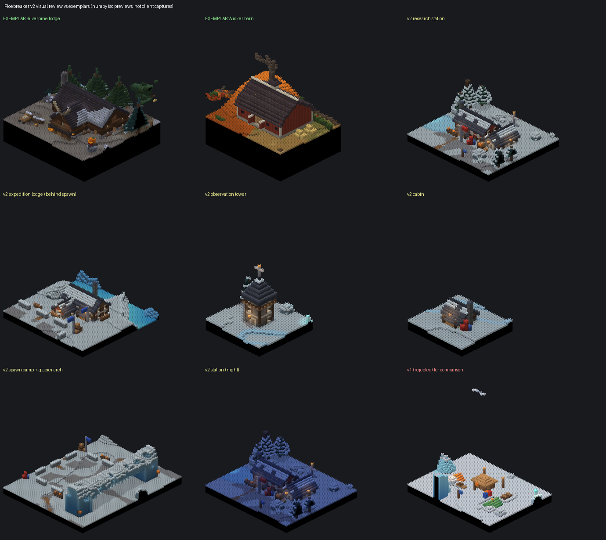

# Floebreaker v2 (Day / Night): the rebuild to the craft standard

v1 (`docs/floebreaker_spec.md`, PR 26) was rejected by the owner on 2026-11-20: *"the structures in this map look
horrible"*, and spawns need improving. v2 keeps v1's gameplay layout (island, ship, whale, routes, tower zones,
sea, icebergs) and rebuilds everything the owner criticised, following `docs/craft_standard.md`.
Files: `maps/floebreaker_v2/`. Generator: `scenes/floebreaker_v2/` (v1 stays untouched in `scenes/floebreaker/`).



## Status ladder
| rung | day | night |
|---|---|---|
| generated / exported / own reader round trip | yes | yes |
| pyspades `generate()` byte-identical, `Map()` load | **yes** | **yes** |
| live piqueserver 1.4.2 Babel probe (platform 3200, `.txt` read, 400 spawns per team in their squares at z 58–59) | **yes** | **yes** |
| client-inspected | **no** (numpy previews only) | **no** |
| playtested | **no** | **no** |

## What changed from v1
| v1 problem | v2 |
|---|---|
| box huts with stepped flat lids, weather towers as stacked boxes | `fb_struct.building()` builds every structure. Stone base course, board-course walls in two close tones, contrasting corner posts and string courses, trim-framed doors and windows (real openings), 45° gable roofs (2 thick, 1-voxel eaves, plank rows, ridge cap, snow on the upper slope), closed gables, stone chimneys, porches, rooms on 1–3 floors with alternating-side stairs, furniture, ceiling lamps, door lanterns, door ramps |
| — | **Research stations** (×4): red or green two-storey hall plus a grey lab wing, porch, antenna mast, flag, fuel drums, crates, sled rack, woodpile. **Expedition lodges** (×2) behind the spawns: timber hall plus a gabled red wing facing the spawn. **Observation towers** (×4): stone storeys, timber top, gallery, steep spire roof. **Cabins** (×4) with porches |
| bare white snowfield, flat colours, no light | palette-guide winter ramp. The snow field sits at luma ~165–180 (dominant `#98A3A9`), with darker packed tracks and drifts, crests ≤ 3 % and slate rock on steep faces. Kit baked light and AO on every surface. Trampled paths and yards link doors, spawns and stations, with plank duckboards between doors. Snow family under 212 after lighting and after glow |
| no dark anchors | **48 snow-laden spruces** (×2 mirrored) in 16 groves: rim hills, flanks, and framing the stations and lodges. Three random details each (lean, snag, double top, icicles, rime, broken top, cones), placed from the decor seed |
| open spawn yard (cover within 8: 8 %), two 30-tall fins as cover | **Spawn compound:** cut-block snow windbreaks with exits on all sides, sled racks, crate and drum stacks, woodpiles and a flag around the square (never on it). The lodge stands behind as a backdrop. A sculpted **glacier arch gate** over the front is the platform cover. Its underside stays ≥ 10 above the ground, so you walk and build under it. It has rounded faces, weathering bites, snow drape and icicles. Cover within 8: **50 %** |
| fog equal to the snow | day fog (202, 180, 200), neutral (65° from blue / 60° from red), not near the ground field; night unchanged, with the night grade lifted (field ~luma 100) |

## Validation (release build, decor seed 2069095157; three extra seeds 101 / 202 / 303 also pass every row)
| check | day | night |
|---|---|---|
| `aosmap.kit.babel_checks` (20 rows incl. 4 zone rules, mirror, traps, interiors) | **all pass** | **all pass** |
| `aosmap.kit.craft_checks` buildings (17 registered: 6 main, 4 small, 4 tower, 2 ruin, 1 vessel) | **17 / 17 pass** | **17 / 17 pass** |
| `craft_checks` spawns (roof 0 %, air-below 0 %, steep 0–3 %, walk-out 100 %, cover within 8 50 %) | **pass** | **pass** |
| spawn exposure from the platform (blue / red) | **3.0 / 2.8 viewers, 64.6 % hidden** (v1: 3.8, 35 %) | same |
| build gap | 55 blocks; platform not reachable on foot | same |
| floating non-sky voxels | 0 | 0 |
| ship floors reachable (hold / deck / B / bridge / roof) | 100 / 100 / 100 / 94 / 100 % | same |
| palette audit | snow over cap 0 %, value bands 150–190: 70 %, 90–150: 25 %; fog only near minor ground tones (ground merge, fine) | ok |
| front exemption | the glacier arch gates (`front_exempt_boxes`), as the owner-accepted gate pattern (Wicker gate oaks, Frostbell gatehouse) | same |

## Visual review (craft standard §5; numpy previews)
| piece | verdict |
|---|---|
| research station | matches the exemplars in form (L-plan, roofs, trim, chimney, yard props, framing spruces); its yard is still plainer than Silverpine's |
| expedition lodge | good massing and roof; its framing grove did not take root (no flat ground clear of the keep-out); the yard is plain |
| observation tower | reads as a tower with a spire; fine |
| cabin | acceptable small building; darker and smaller than ideal |
| spawn camp + arch | much better than v1; the arch is still a heavy mass and the windbreaks read low-key |
| overall | a clear step up from v1. Not yet at Silverpine's density of yard storytelling. Next: client screenshots |

## Known limits
* Not seen in a real client. Check the arch underside clearance at play speed, the duckboards, snow-roof contrast
  against the fog, and team readability (blue on shaded snow).
* The arch gates are tall (top ~z 34) and declared as a front exemption. The owner has accepted gates before but
  has not approved this one.
* `boundary_damage` (box 28–484, damage 1) is still untested in game.
* The decor seed changes trees, penguins and sky pieces per build (owner rule). Every check was run on four seeds.

## Regenerate
```bash
bash scenes/floebreaker_v2/release.sh 2069095157
```
