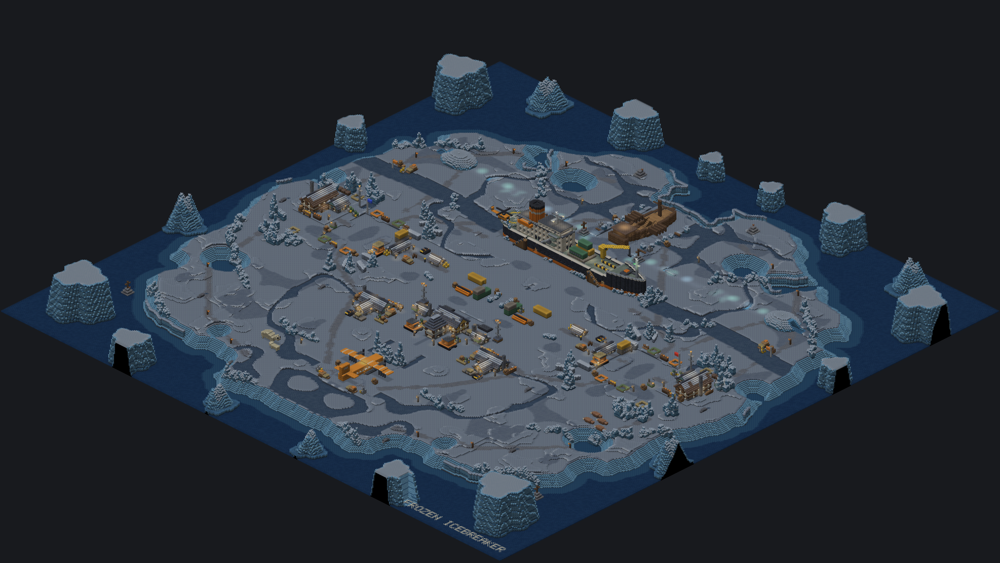

# Frozen Icebreaker v1.0: polar-night pack-ice Babel

**Mode:** stock piqueserver 1.4.2 Babel (`babel_script`), standard variant (no assist structures).
**Author field:** `shywolf91 + AI`. **Origin:** a new map *inspired by* `arctic_icebreaker.vxl` (owner's choice
"inspiration only", 2026-11-20). It shares no terrain or objects with that map or with Floebreaker (the earlier
`[recreate]` of the same file). Concept A "Frozen Icebreaker", picked by the owner from three concepts.
Files: `maps/frozen_icebreaker_v1/`. Generator: `scenes/frozen_icebreaker/` (built with `aosmap.kit`).



## Owner answers `[USER]` (2026-11-20)
| question | answer |
|---|---|
| relation to the attached map | inspiration only |
| ship role | in the centre, beside the platform (not under it) |
| map form / water | big ice island, walkable sea (`water_damage` 0) |
| extras | polar night + glow; under-ice layer. No sky layer |
| left to Claude | fog / sky colours, snow cap, corner tag (SE, on the sea floor), hull colours (black + orange, never team red) |

## Status ladder
| rung | reached |
|---|---|
| specified / generated / exported | yes |
| parser-validated (own reader round trip, pyspades `generate()` byte-identical) | **yes** |
| server-loaded: live piqueserver 1.4.2 Babel probe (map + `.txt` loaded, platform 3200 cells, babel extension, 400 spawns per team inside x 98–138 / 374–414, y 236–276, z 54–55, intel at (256,256,1)) | **yes** |
| client-inspected | **no**: numpy previews only |
| playtested | **no** |

## Layout (SPEC in `scenes/frozen_icebreaker/fi_spec.py`)
| item | value |
|---|---|
| Island | warped superellipse 464 × 428 around (256,256), 65.6 % land. Ice field z 54 (9 above the z 63 sea), coast a 1-per-column slope down to z 62 (one step out of the sea), with 7-high ice cliffs only on the outer coast. Four inland polynyas with slope rims. Solid to the bottom everywhere |
| Ground detail | sastrugi drifts 1–2 high in the skirts, refrozen dark leads (1 below the field), the ship's refrozen wake channel west of the stern, packed sled tracks linking camps, ship, station and wrecks |
| Platform / bases | stock: x 206–305, y 240–271, z 1 (script-built, not in the VXL); bases (118,256) / (394,256) |
| Spawn squares | a shallow hollow: floor z 55 with z 54 mounds, no props |
| Spawn camp (×2, mirrored) | **Expedition lodge** behind the spawn (log hall, 2 floors + teal radio room, porch, chimney, dog kennels, woodpile, sled and ski racks, antenna, generator). Four polar pyramid tents, cut-block snow windbreaks and floe heaps on the enemy-facing corners, team-colour flag mast, lamps |
| Front (spawn → tower zone) | 7 low objects, 17.8 % of the band, all ≤ 10 tall: a two-row supply dump at the spawn edge (double container, snowcat, a walk-through **survey hut** with doors on the spawn-to-tower line), snowmobile pair, cargo sled, an enterable ice-fishing hut, survey tripod, floe heap. Every 8-column section ≥ 56 % free |
| Strip under the platform | cargo lost from the ship: two containers (one half-stacked, doors open), a capsized lifeboat, crates, drums, a floe heap. 20 % of the strip, tops ≥ 43 below the platform; anchor ends flat and bare |
| Tower zones | open flat ice, solid under both platform ends |
| **Icebreaker** (north of the platform, one-off) | x 184–328 along x, y 165–187, beset in pack ice. Black hull with an orange ice belt. Hold (z 61) with engines and cargo; tween deck (z 53) with mess and bunks; main deck (z 44) with hatches, containers and a crane; forecastle (z 39) over a store; superstructure A/B/C decks, boat deck with funnel and lifeboats, bridge with wings, radar mast; helideck with a parked helicopter. Entry: four crushed-hull breaches at ice level, four accommodation ladders, stairs inside throughout |
| **Drift station** (south of the platform) | core-lab hall (2 floors) + enclosed drill tower on x = 256, glaciology lab + workshop wing (×2), generator shed (×2), yard vignettes (core boxes, fuel bladder, snowcat, supply piles, sleds, snowmobiles, weather mast) |
| North flank | wooden **expedition schooner** frozen in on x = 256 (ruin): broken midships with ribs, hold, stern cabin, stump mast, bowsprit, cairns |
| South flank | **crashed ski-plane** on x = 256: enterable cabin, broken wing tips, bent prop, the floe heap it ploughed into |
| Under-ice layer | a blue-ice tunnel from a cave mouth in a snow-capped hummock (north-west, mirrored north-east), a ramp 7 down, a 5-wide gallery (air z 56–60), a crystal chamber with ice pillars, then into the ship's hold through the hull |
| Skirts | pressure ridges (tilted slabs with a gap every ~14), a supply depot, cairns, seals at breathing holes, trail flags, lamp posts; 9 grounded icebergs per side in the sea ring (tabular and pinnacle) |
| One-offs (cosmetic, asymmetric) | a polar bear with her cub (south-west skirts), a walrus haul-out (east shore) |
| Corner tag | "Frozen Icebreaker", painted on the sea floor, south-east |
| Fog | (164, 186, 160) pale aurora green: absent from the palette, 123° from blue and 112° from red (`fog_team_lean` ok) |
| `heavens_color` | (34, 52, 86, 255) (owner's setup only) |
| Glow | 178 sources: ship windows, decks and floodlights, camp and station lamps, door lanterns, aurora crystals in the tunnels. Light is baked into the VXL; `glow_stored_colors` is in the `.txt` |

## Validation (release build, decor seed 850689747; seeds 101 and 202 also pass the same rows)
| check | result |
|---|---|
| `aosmap.kit.babel_checks`: parser, pyspades, floating, mirror (0 outside the declared cosmetic boxes), platform volume, ground under ends, spawn squares, safe descent, routes, traps (0), interiors (46/46), flank (north 478 / south 480), platform not reachable on foot, anchors, 4 zone rules | **all pass** except spawn exposure (below) |
| build gap | 47 blocks (highest reachable near the platform z 49), equal both teams |
| routes spawn → own platform end / enemy spawn | blue 68 / 236, red 69 / 236 |
| zone rules | front 7 objects 17.8 %, p90 height 9; spawn cover enemy side 42.6 %, rear 38.4 %; strip 20.1 %; centre median footprint 32 cells |
| `aosmap.kit.craft_checks` | **14/14 structures pass** (2 main lodges, 2 main labs, main core lab + tower, 6 small huts/sheds, schooner ruin, plane and icebreaker vessels). Spawns pass: roof 0 %, steep ≤ 1 %, walk-out 100 %, cover within 8 **46.6 %** |
| **spawn exposure** (calibrated) | blue 8.64 / red 8.68 mean viewers (target ≤ 10: **met**), **7.9 % hidden (target ≥ 15 %: not met)** |
| `tools/palette_audit.py` | verdict ok: snow 0.4 % (0 % over the cap), max top luma 195, value bands 90–150: 85 %, sparkle 10.6 / 10k |
| determinism | layout fixed (`layout_seed` 20261120); decor from a saved OS seed. The trap repair pass (`open_traps`) opened 0 cells on this seed |

## Open trade-off for the owner `[OPEN]`
**Spawn exposure vs open front.** On the exposure model, a platform eye looks down at 0.6–0.7 voxels per column.
A cover object of height h therefore hides only the spawn spots within about (h − 2)/0.65 columns of it. With
the front capped at 10 tall by the zone rules, only the eastmost spot columns can be hidden. The best result
inside the rules is 7.9 % hidden, with mean viewers already under 10. Ways to reach 15 %, each needing the
owner's call:
1. accept 7.9 % (viewers ≤ 10 is met);
2. an owner-approved spawn gate as a declared front exemption (e.g. an ice arch or a whalebone arch, like the
   accepted Wicker / Frostbell gates);
3. allow one or two front objects up to ~16 tall.

## Known limits
* Not seen in a real client: check the aurora fog against the cyan platform, the night grade on the ice, the
  ship's interior headroom at play speed, and blue players on the shaded blue-grey ice.
* The icebreaker is asymmetric (stern west, bow east). Route costs from each spawn differ: blue / red to the
  west hold 158 / 198, to the bridge 225 / 287. Each team has the same kind of entries in its own half (two
  breaches, two ladders, one tunnel). The bridge vantage (z 24) is 58+ from the platform and 23 below it.
* 871 voxels were capped by `enforce_brightness`, mostly glow-baked surfaces next to lamps.
* `glow_stored_colors` and `heavens_color` are read only by the owner's setup; stock piqueserver ignores them.
* Kit finding: `aosmap.kit.symmetry.fill_pits` compares each column with its *highest* neighbour, not all four
  as its docstring says. On this map it would have raised 16,728 columns (shore, stair feet, wall bases), so it is
  not called. It needs a kit fix (`tooling/` branch).

## Regenerate
```bash
python scenes/frozen_icebreaker/fi_main.py maps/frozen_icebreaker_v1 850689747
python -m aosmap.kit.babel_checks maps/frozen_icebreaker_v1 --out maps/frozen_icebreaker_v1/validation.json
python -m aosmap.kit.craft_checks maps/frozen_icebreaker_v1 --mode babel --out maps/frozen_icebreaker_v1/craft.json
python tools/palette_audit.py maps/frozen_icebreaker_v1/frozen_icebreaker.vxl --fog 164,186,160
python -m aosmap.kit.probe maps/frozen_icebreaker_v1 --mode babel
python -m aosmap.kit.preview maps/frozen_icebreaker_v1
```
`--graybox` skips lighting and glow (gameplay review build).
