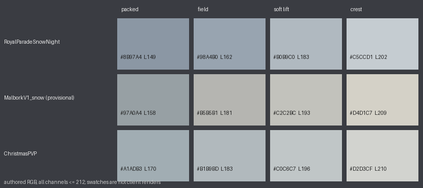

# Coloring snow voxels in classic Ace of Spades

Owner-supplied guide (2026-11-22), integrated into the repo the same day. Read it with
[`colour_palette_guide.md`](colour_palette_guide.md), which **stays authoritative for the general rules** (snow cap,
floors, fog, ramps, audit thresholds). This file adds a per-map winter treatment method, three recolor ramps, and the
exact-colour recolor proof. Where the two differ, the palette guide and AGENTS.md §4 win.

**Status:** researched. The measurements were re-run against the local files (§7). **None of the ramps in this guide has
been seen in OpenSpades or any other client.** Evidence tags follow AGENTS.md §3.

**Contents:** 1 Three winter palettes · 2 What the reference maps actually do · 3 Paint each map differently ·
4 A repeatable painting method · 5 Exact-color editing and proof · 6 Project handoff (who does what) ·
7 Repo cross-check and current understanding · 8 Open items

---

**Give the largest snow surface a quiet middle value.** A player should see the curve of a bank, the packed way through
it, and the lip that catches the light. If every voxel is equally pale, those three features collapse into one field.
If every shadow is violet, the field starts to read as purple stone.

*Swatch sheet drawn in the repo from the table below (authored RGB, not client renders). The guide's original companion
image (raw Icecraft / Yukon top crops) was not supplied with it; regenerate crops from local `refs/` if needed, but don't
commit community-map crops (AGENTS.md §10).*

## 1. Three winter palettes

Read each row from the packed or sheltered snow through to the brightest broken edge. **Broad field** is the colour to
judge first. All values are authored RGB. The project caps each authored snow channel at **212** (AGENTS.md §4), which
also satisfies the example player brief's **221** ceiling. Apply the cap to the snow being authored; a bright sign
elsewhere on an imported map is its own material.

| Map | Packed or shaded | Broad field · RGB | Soft lift | Broken crest | Field luma¹ | crest max channel |
|---|---|---|---|---|---:|---:|
| RoyalParadeSnowNight | `#8B97A4` | **`#98A4B0` · (152, 164, 176)** | `#B0B9C0` | `#C5CCD1` | 162 | 209 |
| MalborkV1_snow · provisional | `#97A0A4` | **`#B5B5B1` · (181, 181, 177)** | `#C2C2BC` | `#D4D1C7` | 181 | 212 |
| ChristmasPVP | `#A1ADB3` | **`#B1B9BD` · (177, 185, 189)** | `#C0C6C7` | `#D2D3CF` | 183 | 211 |

¹ Project luma is `0.299R + 0.587G + 0.114B` on 0–255 RGB (`aosmap.kit.palette.luma`). It compares paint values only.
OpenSpades adds sun and ambient shading and mixes in fog, so final brightness depends on the scene. Judge comfort from
the player's view. ([OpenSpades terrain shader](https://github.com/yvt/openspades/blob/master/Resources/Shaders/BasicBlock.fs))

Step luma `[RUN]`: Royal 149 / 162 / 183 / 202 · Malbork 158 / 181 / 193 / 209 · Christmas 170 / 183 / 196 / 210.

## 2. What the reference maps actually do

`[RUN]` The table samples one location per file so the colours are reproducible. Percentages use **all land tops**:
columns whose highest solid voxel has `z < 62`, trees and buildings included. A blue channel above 221 can coexist with
dark red and green, so the percentage measures cap compliance, not glare.

| Local reference | Raw top RGB at (x=325, y=225) | Land tops with any channel above 221 | Artistic cue worth keeping |
|---|---|---:|---|
| Icecraft · `icecraft.vxl` | (177, 229, 255) at z=57 | 46,857 / 56,364 · **83.1 %** | Rounded blue banks enclose lighter pockets. Carry one broad tonal change around a bend, then let it fade. |
| Yukon · `yukon.vxl` | (136, 193, 251) at z=60 | 82,015 / 92,032 · **89.1 %** | Narrower, winding bands describe hollows and cuts. Use the direction of the bands to lead the eye through a route. |
| Icecream | **Unverified** – exact file not in `H:\maps` | Unmeasured | When supplied, sample an open field, a shaded bank and a route edge. Record coordinates and a top crop before attributing any colour or pattern to it. |

Keep the **shapes and colour placement** of Icecraft and Yukon; compress their **colours** into the four-step ramp. Their
raw channel peaks are far over budget. Example: a Yukon-like hollow in a Christmas arena becomes a connected blue-grey
trough flowing into two neutral field tones; it still reads as a hollow once the saturated blue is gone. Fresh snow is
close to white in broad light and deeper snow can show a blue tint, so a small cool shift in recessed snow is a
recognisable cue. ([NSIDC, *The colors of snow*](https://nsidc.org/learn/parts-cryosphere/snow/science-snow))
`[GUIDE]`

## 3. Paint each map differently

Every winter map gets its own controlled treatment. Same cap, same method, different light, field, pattern and anchor.

**RoyalParadeSnowNight · a moonlit street.** `[RUN]` Every one of its 66,351 land tops is `#DDDDDD`; 43,633 sit at z=56,
so a height-only formula would repaint most of the avenue in one flat tone. The sidecar fog is pale lavender
`(230, 230, 250)`. `[DESIGN]` Keep the broad ground blue-grey and let the existing fog carry the lavender. Run shallow,
interrupted sweeps parallel to the street. Put the trough near a façade or in a worn approach. Give an exposed roof lip a
short soft lift. Across a long sightline players should still tell roof, street and sky apart.

**MalborkV1_snow · snow against warm masonry.** `[RUN]` The available **non-snow** `MalborkV1.vxl` has warm terracotta
`#A85A32` on 29,436 of 37,449 land tops. That is architectural context only. **The snow edition and its fog are
unverified** (not in `H:\maps`). `[DESIGN]` Start the courtyard snow near neutral and let the terracotta supply the
warmth. Group soft lifts in broad apron-shaped patches at the foot of walls. Along exposed ledges, break the cream crest
wherever the ledge turns away. Compare snow beside a red roof and beside grey stone; if both snow and masonry look beige,
cool the field slightly before changing the trim. Apply this only to matching voxels in the actual snow edition.

**ChristmasPVP · soft snow around colourful play spaces.** `[RUN]` The original `#BECBD2` has luma 200 and already meets
both numeric caps; the problem is coverage and repetition: 30,863 of 56,794 land tops (54.3 %). The map also has warm
brown paths, deep reds and blue accents. `[DESIGN]` Lower the field to luma 183. Follow the curves of plazas and
approaches with broad, rounded pillows. Flatten to the packed tone at busy entrances, and break a restrained warm crest
around the outer edge of a bank. Keep the red and blue details easy to find. On vertical snow-coloured faces, carry the
field around the corner and use a restrained shade below the lip.

## 4. A repeatable painting method

1. **Pick the view and the field first.** From spawn, frame the biggest slope or open lane with a darker object already
   in the scene. Overcast map: start around luma 165–185. Night map: lower the field to fit the grade but keep it the
   lightest broad ground material (palette guide §4.2). Choose a neutral rock, timber wall or treeline that makes the
   snow readable by contrast. Walkable floors stay ≥ luma 40. `[USER / DESIGN]`
2. **Block in four connected shapes.** First thumbnail: **70 % field, 18 % packed or sheltered, 10 % soft lift, 2 %
   crest** of visible snow tops. Starting proportions, not measured from the references. A sheltered courtyard may have
   no crest. A field colour should survive across a clean stretch several player-widths wide. `[DESIGN]`
3. **Give the pattern a cause.** Open ground: stretch a patch along one wind direction. Near a gate: bend it along the
   path. Roof: use its ridge, edge and slope. First pass: a **12–30 voxel** body, a **3–8 voxel** transition, a crest in
   broken **3–10 voxel** runs; shorter on a small ledge. A generator derives shapes from distance to a path or edge,
   local height change and a fixed, smoothly varying noise field sampled in map coordinates; blend within the ramp and
   **record the seed**. Avoid independent random colour per block, rigid rings around every object and unbroken
   outlines (palette guide §4.2 sparkle target). `[DESIGN]`
4. **Separate snow from other materials.** On a new build, snow settles on upper ledges and branches and leaves some
   material visible. Ice gets a cooler, smoother band; rock a darker face; walked snow a quieter centre. On a recolor,
   express these cues through the existing mask and geometry only. Shade sparingly under a lip; the client also shades.
   `[DESIGN]`
5. **Correct the visible failure.** Dazzling field → less bright area first, then a lower field. Purple-looking ground →
   move red and blue toward green and retest in the same fog. Concrete-looking snow → a drift edge, a packed route or a
   dark material beside it. A ridge lost in fog → more value separation at its silhouette. Recolors are tuned with the
   original fog active; new maps evaluate fog with the palette (~150+ per channel, hue the palette doesn't use, neutral
   between Blue and Red; palette guide §6). `[DESIGN / USER]`

## 5. Exact-color editing and proof

Classic VXL stores columns of spans in a 512 × 512 × 64 world; smaller z is higher. A column can hold several surfaces,
and stored colours sit on the top, sides or underside of exposed solids. Each stored entry is B, G, R and a fourth byte
(the repo reader calls it the shade byte; pyspades writes `0x80` for opaque colours, `aosmap/vxl.py` `DEFAULT_SHADE`).
Author in RGB, **preserve the fourth byte**, and leave implicit interior solids alone. Fog comes from server state and
can change independently of the terrain. `[SRC]` [`vxl_and_runtime_reference.md`](vxl_and_runtime_reference.md) ·
[VXL format](https://www.piqueserver.org/aosprotocol/mapformat.html) ·
[0.75 protocol](https://www.piqueserver.org/aosprotocol/protocol075.html)

| Exact target key | All stored matches | What a top-only pass would miss |
|---|---:|---|
| RoyalParadeSnowNight · `#DDDDDD` (221,221,221) | **66,376** | 23 matches at z=63 in the map-credit lettering and 2 below the top surface. Give the 23 glyph pixels one consistent light neutral from the ramp and inspect the lettering at map scale. |
| MalborkV1_snow · `#DDDDDD` | **Pending exact file** | Count from the supplied edition. The non-snow castle and the partial `MalborkV1.vxl.part` are not valid inputs. |
| ChristmasPVP · `#BECBD2` (190,203,210) | **141,803** | 11,911 are column tops at z=62 and 99,029 sit below column tops: roof edges, exposed sides, sheltered areas. |

`[RUN]` SHA-256 prefixes: `2c022e0b0d49` Royal, `b029818c8d7f` Christmas, `24e7b08b2276` Icecraft, `e3d47fdc1eb3`
Yukon, `ee14731a8c88` non-snow Malbork. On another revision, fingerprint and recount before using these as baselines.

**Mask (Juno).** Compute it once from the original decoded data:
`mask = before.colored & ((before.color & 0xFFFFFF) == source_rgb24)`. Every match counts, special layers included. Read
terrain context from neighbours freely, write RGB **only inside the frozen mask**, and keep bits 24–31. No raw byte-string
replace across span headers. Matching pixels on lettering or another authored detail map uniformly to one close shade.
Don't run `kit.color.enforce_brightness` or a lighting pass over the whole map on a recolor: both touch off-mask voxels.

**Verify the export (Kit).** Reopen both VXLs and compare. Each must be **zero**: occupancy differences, stored-colour
mask differences, fourth-byte differences, RGB differences outside the mask. Inside the mask: changed = original match
count, original key remaining = 0, max output channel ≤ 212. Report the ramp histogram, crest share on edited snow tops,
both SHA-256s and the seed; rebuild in a fresh process for the same SHA-256. Also run `tools/palette_audit.py` (map-wide:
it sees unrelated materials and skips some layers, so it complements the exact comparison) and the reader + pyspades
round trip; record any pre-existing import normalisation separately from new regressions.

**Inspect from player height.** Same position, facing, client settings and fog before and after. Capture the spawn exit,
the longest open lane, a bank beside a dark wall, and a roof or raised edge against the sky. Strafe past the bank for
sparkling pixels. Put Blue and Red against the same distant snowbank and check edge, silhouette and route. For Royal, also
inspect the map credit. Label numpy and `fp_view` frames as previews; claim `client-inspected` only after someone looks in
a client. **Mark every check that was not performed.**

## 6. Project handoff (who does what)

* **Cleo (`map-designer`), new winter map:** each concept names the **lighting**, the **colour filling the largest
  playable snowfield**, the **terrain feature that shapes its pattern** (one reference shape, §2) and the **adjacent
  material that makes the snow legible**.
* **Juno (`map-builder`):** specifies packed / field / soft lift / crest in RGB, each tied to a path, ledge, slope or
  shelter; records patch scale and seed in the SPEC and `build.json`. Recolors: the frozen exact mask of §5, preserving
  geometry, other materials and fourth bytes.
* **Kit (`map-runner`):** measures the whole exact mask as well as land tops; the §5 zero-diff table; the same views in
  OpenSpades with the map's fog when a client is available; evidence for glare, moving sparkle, the skyline and both team
  silhouettes; status ladder with every unperformed check marked.
* **Rhea (`aos-guru`):** an existing exact-colour recolor stays **Tier S** (`.claude/commands/new-map.md` step 0: Juno
  for the art, Kit for evidence, no concepts). She reviews that each map gets a controlled, distinct winter treatment
  (not one ramp everywhere), and accepts a reference claim (Icecream, Malbork snow, any "map X does Y") only when the
  source map or source document is in hand and supports it.

## 7. Repo cross-check and current understanding (2026-11-22)

* **Measurements reproduced** `[RUN]`. Every count, SHA-256 prefix, sample RGB and percentage in §2, §3 and §5 was
  re-run with `aosmap.vxl.read_vxl` on `H:\maps` and matched exactly (66,376 = 66,351 land tops + 23 z=63 + 2 below;
  141,803 = 30,863 + 11,911 + 99,029). Icecream and the Malbork snow edition are absent there.
* **Recolors already in the repo.** `maps/royal_parade_snow_night_v2_recolor/` and `maps/christmas_pvp_v2_recolor/`
  (owner request 2026-11-22, both liked) use a **darker night grade** plus glow; Royal's recolor puts land-top luma p50 at
  115 (spec `docs/royal_parade_snow_night_v2_spec.md`). The ramps here are a **brighter, cap-bound alternative**
  (Royal field 162). A run of them is a new versioned copy kept side by side; never overwrite a released version
  (AGENTS.md §4). Which grade the owner prefers for Royal is his call.
* **Headroom.** The palette guide asks for a field luma ≤ ~180 so the crest still shows under 212. Malbork (181) and
  Christmas (183) sit at that edge; their crest steps (+28, +27 luma) still fit. Watch the crest in the client before
  raising the field.
* **ChristmasPVP .txt has no fog line**, so the client default applies; inspect with what the server actually sends.
* **Crest share.** §4's 2 % thumbnail sits inside the palette guide's "brightest band ≤ ~5 %" target.

## 8. Open items `[OPEN]`

* None of the three ramps has been client-inspected (OpenSpades, BetterSpades or aos_web).
* Icecream: no file; no claim about its colours or patterns may be used.
* MalborkV1_snow: no file; ramp provisional, match count pending.
* Royal: owner choice between the existing night-grade recolor and this ramp.
